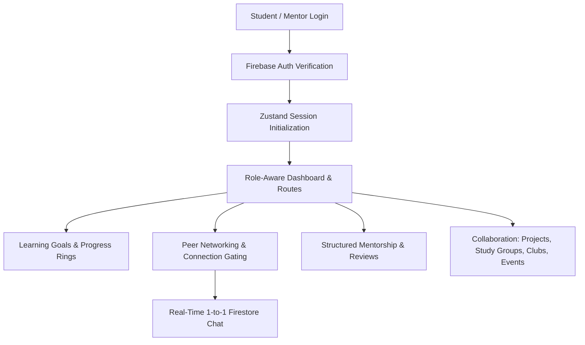

# SkillSync: Technical Approach & Architecture

## 1. Core Technologies
* **Frontend Framework:** React 19 (Functional components, hooks, concurrent features)
* **Build Tool:** Vite 6 (Fast Hot Module Replacement, optimized ES modules production bundling)
* **Language:** TypeScript 5.8 (Strict type checking, end-to-end interface contracts)
* **Styling:** Tailwind CSS 4 (Zero-runtime utility CSS, custom color token design system)
* **Routing:** React Router 7 (Nested route hierarchy with `AuthGuard` and `RoleGuard`)
* **State Management:** Zustand 5 (Lightweight reactive client-side store for auth, session, and toasts)
* **Icons & Animation:** Lucide React icons & Motion (light, accessible UI transitions)
* **Date Utilities:** date-fns (relative time formatting and timestamp parsing)

## 2. Backend & Cloud Infrastructure
* **Hosting Server:** Node.js with Express (`server.ts` handles SPA routing and Vite dev middleware)
* **Authentication:** Firebase Authentication (Email/password and Google Sign-In)
* **Database:** Google Cloud Firestore (NoSQL document store with composite indexing)
* **Real-time Sync:** Firestore `onSnapshot` subscriptions (Used for 1-to-1 messaging, notifications, and study group discussions)
* **Access Control:** Firestore Security Rules (Strict role checks, connection-gated chat, and self-escalation prevention)

---

## 3. Implementation Methodology & Process

### 3.1 Agile Feature-Driven Development
The codebase follows a feature-sliced architecture (`src/features/*`), isolating:
- Domain services (`*Service.ts`)
- Zustand stores (`*Store.ts`)
- Presentation components and views

### 3.2 System Architecture Flow

### 3.3 Zero Overhead Design Choices
1. **No External AI API Dependencies**: Peer discovery and resource recommendations use an efficient, deterministic rule-based matching engine comparing declared student goals/skills against resource tags and mentor qualifications.
2. **No WebRTC or Custom Socket Servers**: Collaborative whiteboards and fragile P2P streaming were replaced with lightweight, institutional-grade Google Meet/Zoom room links and persistent Firestore group notes.
3. **No Storage Bloat**: Learning materials and lecture slides are stored as verified external URLs and metadata links.

---

## 4. Working Prototype Status
* **Full End-to-End Capabilities:** Account registration, role approval workflow, profiles, learning resources catalog, personal progress tracker, peer connections, 1-on-1 real-time chat, mentorship workflow with 1-5 star reviews, project hub, study group workspace with shared notes, clubs, events RSVP, community feed with moderation reports, and admin moderation portal.
* **Responsive Layout:** Tested across desktop, tablet, and mobile views with an accessible drawer navigation shell.
