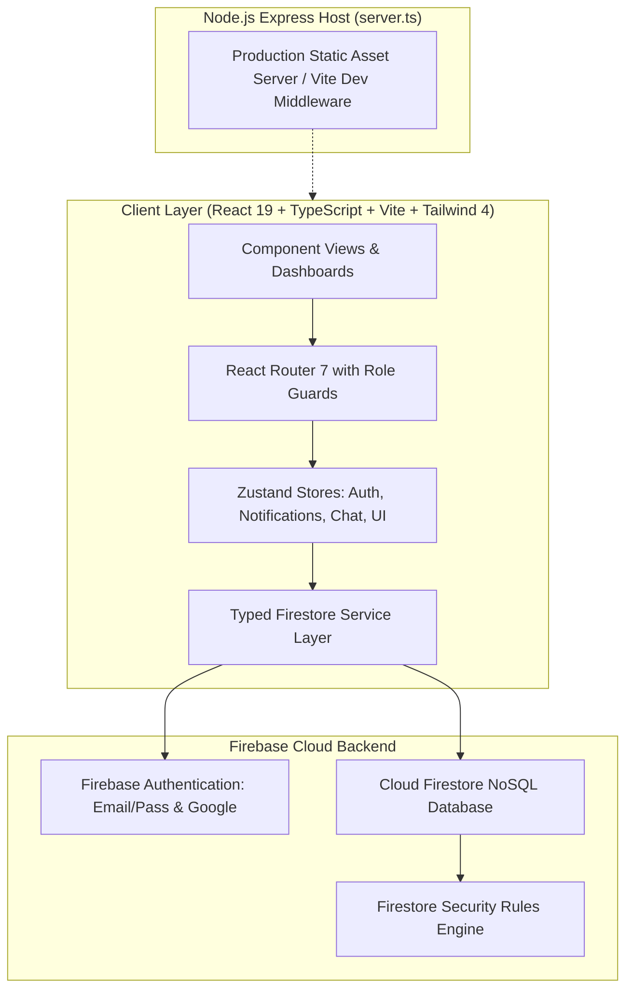

# SkillSync: System Design & Architecture Specification

---

## 1. System Architecture Overview

SkillSync employs a modern, reactive single-page application (SPA) architecture backed by Firebase Cloud Firestore, Firebase Authentication, and a lightweight Node/Express host.



### Architectural Principles:
1. **Zero Unused Overhead**: No Socket.io, no WebRTC, no AI heavy SDKs. Chat and collaborative updates leverage Firestore `onSnapshot` real-time listeners natively with subcollection index optimizations.
2. **Role-Governed Access Control**: Enforced both client-side via navigation guards and server-side via Firestore Security Rules.
3. **Decoupled Service Layer**: All Firestore operations reside in typed service modules (`src/services/` and `src/features/*/services`), ensuring views remain pure presentation layers.
4. **Resilient Offline & Error Handling**: Graceful degradation, optimistic UI toggles, skeleton loaders, and non-blocking toast notifications.

---

## 2. Firestore Data Model & Schema

All collections and documents are structured for scalability, sub-collection isolation, and role-based security validation:

### 2.1 Collection: `users` (Private Auth & System State)
- **Path**: `/users/{uid}`
- **Access**: Read/write exclusively by the owner user or Admin.
```typescript
interface UserDoc {
  uid: string;
  email: string;
  role: 'student' | 'senior' | 'faculty' | 'clubCoordinator' | 'admin';
  status: 'active' | 'pending' | 'suspended';
  createdAt: string; // ISO 8601
  updatedAt: string;
}
```

### 2.2 Collection: `profiles` (Public / Connection Academic Info)
- **Path**: `/profiles/{uid}`
- **Access**: Read by authenticated users; update by owner (with rating fields protected against direct edit).
```typescript
interface ProfileDoc {
  uid: string;
  displayName: string;
  photoURL: string;
  bio: string;
  department: string;
  year: string; // e.g., "1st Year", "2nd Year", "Alumni", "Faculty"
  skills: string[]; // skills mastered
  interests: string[]; // skills learning / interests
  role: 'student' | 'senior' | 'faculty' | 'clubCoordinator' | 'admin';
  badges: string[]; // ['first_connection', 'mentor', 'resource_sharer', 'project_starter', 'event_attendee', 'course_completer']
  ratingAverage: number; // 0 to 5.0
  ratingCount: number;
  privacy: 'public' | 'connections';
  createdAt: string;
  updatedAt: string;
}
```

### 2.3 Collection: `connections` (Peer Networking)
- **Path**: `/connections/{connectionId}` (where `connectionId = [uidA, uidB].sort().join('_')`)
- **Access**: Only participants (`uidA` or `uidB`) can read/write.
```typescript
interface ConnectionDoc {
  id: string;
  users: [string, string]; // [uidA, uidB]
  requesterId: string;
  recipientId: string;
  status: 'pending' | 'accepted' | 'rejected';
  note?: string;
  createdAt: string;
  updatedAt: string;
}
```

### 2.4 Collection: `messages` & Subcollection `chats`
- **Path**: `/conversations/{conversationId}/messages/{messageId}`
- **Access**: Read and write restricted strictly to confirmed, mutually accepted connections.
```typescript
interface ConversationDoc {
  id: string; // [uidA, uidB].sort().join('_')
  participants: [string, string];
  lastMessageText: string;
  lastMessageAt: string;
  unreadCount: { [uid: string]: number };
}

interface MessageDoc {
  id: string;
  conversationId: string;
  senderId: string;
  senderName: string;
  senderPhoto?: string;
  text: string;
  createdAt: string;
  read: boolean;
}
```

### 2.5 Collection: `mentorships` & `mentorshipReviews`
- **Path**: `/mentorships/{mentorshipId}`
```typescript
interface MentorshipDoc {
  id: string;
  studentId: string;
  studentName: string;
  studentPhoto?: string;
  mentorId: string;
  mentorName: string;
  mentorPhoto?: string;
  topic: string;
  message: string;
  status: 'pending' | 'accepted' | 'rejected' | 'completed';
  meetingLink?: string; // Optional Google Meet / Zoom link
  reviewed: boolean;
  createdAt: string;
  updatedAt: string;
}

interface MentorshipReviewDoc {
  id: string;
  mentorshipId: string;
  studentId: string;
  studentName: string;
  mentorId: string;
  rating: number; // 1 to 5
  comment: string;
  createdAt: string;
}
```

### 2.6 Collection: `learningResources`
- **Path**: `/learningResources/{resourceId}`
```typescript
interface LearningResourceDoc {
  id: string;
  title: string;
  description: string;
  url: string;
  type: 'course' | 'video' | 'article' | 'documentation' | 'roadmap';
  skillTags: string[];
  addedByUid: string;
  addedByName: string;
  addedByRole: string;
  createdAt: string;
}
```

### 2.7 Collection: `learningGoals`
- **Path**: `/learningGoals/{goalId}`
```typescript
interface LearningGoalDoc {
  id: string;
  uid: string;
  skillName: string;
  targetDate?: string;
  status: 'not_started' | 'in_progress' | 'completed';
  progressPercentage: number; // 0 - 100
  resourceItems: {
    resourceId?: string;
    title: string;
    url?: string;
    completed: boolean;
  }[];
  createdAt: string;
  updatedAt: string;
}
```

### 2.8 Collection: `projects`
- **Path**: `/projects/{projectId}`
```typescript
interface ProjectDoc {
  id: string;
  title: string;
  description: string;
  requiredSkills: string[];
  maxMembers: number;
  isOpen: boolean; // open (immediate join) or restricted (join request required)
  ownerId: string;
  ownerName: string;
  ownerRole: string;
  members: {
    uid: string;
    name: string;
    role: string;
    photoURL?: string;
    joinedAt: string;
  }[];
  joinRequests: {
    uid: string;
    name: string;
    photoURL?: string;
    message?: string;
    status: 'pending' | 'accepted' | 'rejected';
    requestedAt: string;
  }[];
  repoUrl?: string;
  createdAt: string;
  updatedAt: string;
}
```

### 2.9 Collection: `studyGroups`
- **Path**: `/studyGroups/{groupId}`
- **Subcollection**: `/studyGroups/{groupId}/messages/{messageId}`
```typescript
interface StudyGroupDoc {
  id: string;
  topic: string;
  description: string;
  scheduleText: string;
  meetingLink?: string; // Optional Google Meet / Zoom URL
  ownerId: string;
  ownerName: string;
  members: {
    uid: string;
    name: string;
    photoURL?: string;
    joinedAt: string;
  }[];
  notes: string;
  lastEditedBy?: string;
  lastEditedByName?: string;
  lastEditedAt?: string;
  createdAt: string;
  updatedAt: string;
}
```

### 2.10 Collection: `clubs`
- **Path**: `/clubs/{clubId}`
```typescript
interface ClubDoc {
  id: string;
  name: string;
  category: string;
  description: string;
  logoURL?: string;
  bannerURL?: string;
  coordinatorId: string;
  coordinatorName: string;
  followers: string[]; // array of uids
  announcements: {
    id: string;
    title: string;
    content: string;
    postedAt: string;
    postedByName: string;
  }[];
  createdAt: string;
  updatedAt: string;
}
```

### 2.11 Collection: `events`
- **Path**: `/events/{eventId}`
```typescript
interface EventDoc {
  id: string;
  title: string;
  description: string;
  category: 'hackathon' | 'workshop' | 'seminar' | 'competition' | 'meetup' | 'other';
  date: string;
  time: string;
  location: string;
  meetingLink?: string;
  capacity: number;
  clubId?: string;
  clubName?: string;
  organizerId: string;
  organizerName: string;
  registrations: {
    uid: string;
    name: string;
    email: string;
    registeredAt: string;
  }[];
  status: 'active' | 'cancelled';
  createdAt: string;
  updatedAt: string;
}
```

### 2.12 Collection: `posts`
- **Path**: `/posts/{postId}`
```typescript
interface PostDoc {
  id: string;
  authorId: string;
  authorName: string;
  authorRole: string;
  authorPhoto?: string;
  content: string;
  resourceLink?: string;
  likes: string[]; // array of uids
  comments: {
    id: string;
    authorId: string;
    authorName: string;
    authorPhoto?: string;
    text: string;
    createdAt: string;
  }[];
  createdAt: string;
}
```

### 2.13 Collection: `reports`
- **Path**: `/reports/{reportId}`
```typescript
interface ReportDoc {
  id: string;
  reporterId: string;
  reporterName: string;
  targetType: 'post' | 'comment' | 'user';
  targetId: string;
  targetContentSnippet: string;
  reason: 'spam' | 'harassment' | 'misinformation' | 'inappropriate' | 'other';
  notes?: string;
  status: 'open' | 'resolved' | 'dismissed';
  resolvedByUid?: string;
  resolvedAt?: string;
  actionTaken?: string;
  createdAt: string;
}
```

### 2.14 Collection: `notifications`
- **Path**: `/notifications/{notificationId}`
```typescript
interface NotificationDoc {
  id: string;
  recipientUid: string;
  senderUid?: string;
  senderName?: string;
  type:
    | 'connection_request'
    | 'connection_accepted'
    | 'mentorship_request'
    | 'mentorship_accepted'
    | 'mentorship_completed'
    | 'project_join_request'
    | 'project_joined'
    | 'event_registered'
    | 'role_approved'
    | 'badge_awarded'
    | 'report_resolved';
  title: string;
  message: string;
  linkUrl: string;
  read: boolean;
  createdAt: string;
}
```

### 2.15 Collection: `moderationLogs`
- **Path**: `/moderationLogs/{logId}`
```typescript
interface ModerationLogDoc {
  id: string;
  adminUid: string;
  adminName: string;
  action: 'approve_role' | 'change_role' | 'suspend_user' | 'reactivate_user' | 'delete_user' | 'remove_post' | 'dismiss_report';
  targetId: string;
  targetDescription: string;
  timestamp: string;
}
```

### 2.16 Collection: `flashCardDecks` & `flashCards` (Self-study module)
- **Path**: `/flashCardDecks/{deckId}`
- **Subcollection**: `/flashCardDecks/{deckId}/cards/{cardId}`
```typescript
interface FlashCardDeckDoc {
  id: string;
  uid: string;
  skillTag: string;
  title: string;
  description: string;
  isPublic: boolean;
  cardCount: number;
  createdAt: string;
}

interface FlashCardDoc {
  id: string;
  front: string;
  back: string;
  order: number;
}
```

---

## 3. Security Rules Architecture (`firestore.rules`)

The security rules enforce:
1. **Authentication Requirement**: `request.auth != null` for any operational access.
2. **User Isolation**:
   - `/users/{uid}` can only be read/updated by the corresponding user or admins.
   - Self-escalation of roles (`role` or `status`) is explicitly rejected in write rules.
3. **Connection-Gated Messaging**:
   - Messages can only be read and written if the requestor belongs to an existing `accepted` connection document between the two participants.
4. **Role Privileges**:
   - Creating learning resources requires role in `['senior', 'faculty', 'clubCoordinator', 'admin']`.
   - Managing club announcements and events requires being the designated club coordinator or admin.
   - Access to `/reports` and `/moderationLogs` is strictly restricted to `request.auth.token.role == 'admin'` or admin user doc.
5. **Mentorship Reviews**:
   - Only the student on an accepted & completed mentorship can submit a review.

---

## 4. Route Architecture & Role-Based Navigation

SkillSync provides complete, role-governed routing:

```
/                         -> Landing Page (Public)
/login                    -> Login Page (Public/Guest)
/register                 -> Register Page (Public/Guest)
/forgot-password          -> Password Reset Request (Public/Guest)

--- Protected App Shell (Authenticated) ---
/dashboard                -> Role-Aware Dashboard (Student Progress / Senior & Faculty Mentoring)
/profile/:uid             -> User Profile View (Public / Connections-Only)
/profile/edit             -> Edit My Profile & Privacy Settings
/resources                -> Learning Resources Catalog
/resources/new            -> Publish Learning Resource (Senior, Faculty, Coordinator, Admin)
/progress                 -> Personal Learning Goals & Skill Tracker
/network                  -> Peer Discovery & Connection Management
/mentorship               -> Mentorship Portal (Request, Manage, Rate)
/messages                 -> Real-Time 1-to-1 Chat
/projects                 -> Collaboration Projects Hub
/projects/:id             -> Project Details & Member Management
/study-groups             -> Study Groups Directory
/study-groups/:id         -> Study Group Workspace (Chat & Shared Notes)
/clubs                    -> Campus Clubs Directory
/clubs/:id                -> Club Details & Bulletin Board
/events                   -> Campus Events & Hackathons Directory
/events/:id               -> Event RSVP & Attendee Details
/feed                     -> Campus Community Feed & Interactions
/notifications            -> Notification Center
/flashcards               -> Interactive Study Flashcard Decks

--- Role Guarded Portals ---
/coordinator              -> Club Coordinator Management Portal (Club Coordinator & Admin only)
/admin                    -> Administrator Portal (Admin only)
*                         -> 404 Not Found Page
```

---

## 5. UI Design System Tokens & Component Library

To provide a consistent, fresh, academic-yet-modern feel:
- **Primary Color Palette**: Royal Indigo (`indigo-600` primary, `indigo-500` hover, `indigo-50` background tint).
- **Accent Color Palette**: Crisp Teal (`teal-500` accent, `teal-50` subtle highlights).
- **Neutral Grays**: Slate tones (`slate-900` text headings, `slate-600` body text, `slate-100` card borders, `slate-50` canvas).
- **Status Colors**: Emerald (`success`), Amber (`warning`), Rose (`danger`), Sky (`info`).
- **Typography**: Clean modern sans typography scale, tabular numbers for stats and dates.
- **Design System Components (`src/components/ui/*`)**:
  - `Button`: Primary, secondary, outline, ghost, danger variants; supports loading state with spinner.
  - `Card`: Surface container with subtle borders and gentle hover lifts.
  - `Input` & `Textarea`: Accessible field inputs with label, helper text, and validation error messages.
  - `Select`: Custom-styled select dropdown.
  - `Modal`: Accessible dialog overlay with escape key dismissal and backdrop click handling.
  - `Badge`: Role badges, category pills, status indicators.
  - `Avatar`: User avatar with fallback initials and role indicator dot.
  - `Tabs`: Segmented tab buttons with smooth active transitions.
  - `Toast`: Global notification toast system for non-blocking feedback.
  - `EmptyState`: Clean illustration/icon placeholder with title, description, and action button.
  - `Skeleton`: Shimmering placeholder skeletons for cards, tables, and profiles.
  - `Pagination`: Accessible page navigator with previous/next and page count.
  - `ConfirmDialog`: Confirmation modal for destructive operations (delete post, leave project, cancel event).
  - `ProgressRing`: SVG-based circular progress indicator for learning goal mastery.
  - `StatCard`: Standardized dashboard statistic card with icon, metric, label, and trend.
